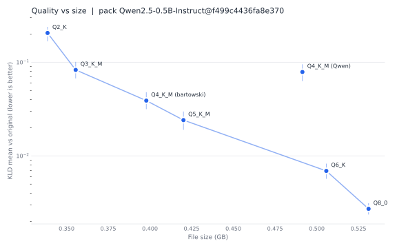

<p align="center">
  
</p>

<h1 align="center">quantgap: how much did this quant lose?</h1>

<p align="center">
  <a href="https://github.com/saqlain2204/quantgap/actions/workflows/ci.yml"></a>
  <a href="https://huggingface.co/quantgap-packs"></a>
  <a href="https://saqlain2204.github.io/quantgap/"></a>
  
  <a href="LICENSE"></a>
</p>

**quantgap measures how far a quantized model drifts from the original, on your own machine, without running the original.**

<p align="center">
  <a href="docs/launch.mp4" title="Watch the 87-second launch video">
    
  </a>
  <br>
  <sub>Click for the full <a href="docs/launch.mp4">87-second launch video</a> (1080p): what it does, how to use it, real results.</sub>
</p>

```text
Which quant should I download?   Q4_K_M?  UD-Q4_K_XL?  IQ3_XXS?  NVFP4?
```

People answer that with feelings. quantgap answers it with a number: how much each quant moved away
from the real model, measured the same way for every publisher and every format.

## Quickstart

```bash
pip install "quantgap[llamacpp]"

# how much did this one file lose?
quantgap score hf://<publisher>/<model>-GGUF/<file>.gguf

# score many quants of one model, draw a chart, and get a pick for your memory
quantgap compare --repo <publisher>/<model>-GGUF --glob "*Q4*" --budget 16GB --chart chart.svg
```

You need a **pack** for the model (the original's answers on a fixed set of texts, made once and
shared). Pass one with `--pack`, or let quantgap look one up on the Hub. See
[Make a pack for your own model](#make-a-pack-for-your-own-model).

## Sample result (real, small, one machine)

Model: `Qwen/Qwen2.5-0.5B-Instruct` (Apache-2.0). Its pack is public at
[quantgap-packs/Qwen2.5-0.5B-Instruct](https://huggingface.co/datasets/quantgap-packs/Qwen2.5-0.5B-Instruct),
so `quantgap score hf://bartowski/Qwen2.5-0.5B-Instruct-GGUF/Qwen2.5-0.5B-Instruct-Q4_K_M.gguf` finds it by itself. The numbers below were measured by quantgap on one
CPU laptop, against a pack made from the original weights. Full table, hashes and settings:
[docs/RESULTS.md](docs/RESULTS.md).

| Publisher | Quant | Size | KLD mean (95% interval) | Worst 1% | Top-1 | PPL ratio | Loops (quant / original) | Wrong script | JSON ok |
|---|---|---|---|---|---|---|---|---|---|
| bartowski | Q8_0 | 531.1 MB | 0.0027 (0.0024 to 0.0031) | 0.027 | 97.1% | 1.003 | 5 / 6 | 0 | 2 / 2 |
| bartowski | Q6_K | 505.7 MB | 0.0069 (0.0057 to 0.0083) | 0.064 | 95.5% | 1.008 | 8 / 6 | 0 | 2 / 2 |
| bartowski | Q5_K_M | 420.1 MB | 0.0241 (0.0190 to 0.0298) | 0.264 | 92.3% | 1.024 | 5 / 6 | 0 | 2 / 2 |
| bartowski | Q4_K_M | 397.8 MB | 0.0389 (0.0316 to 0.0478) | 0.376 | 89.9% | 1.041 | 6 / 6 | 0 | 2 / 2 |
| Qwen | Q4_K_M | 491.4 MB | 0.0787 (0.0627 to 0.0950) | 0.807 | 85.8% | 1.064 | 7 / 6 | 0 | 2 / 2 |
| bartowski | Q3_K_M | 355.5 MB | 0.0828 (0.0672 to 0.1009) | 0.852 | 85.9% | 1.073 | 7 / 6 | 0 | 2 / 2 |
| bartowski | Q2_K | 338.6 MB | 0.2052 (0.1672 to 0.2386) | 2.080 | 77.8% | 1.200 | 9 / 6 | 0 | 2 / 2 |

Quick mode (first 25% of each group, 12 greedy prompts), llama.cpp on CPU, one machine. Lower KLD is better. Loops are counted out of 12 prompts, so differences of one or two are noise.



**One finding worth a second look:** the two files labelled `Q4_K_M` are not the same quality. The official Qwen file (491 MB) drifted about twice as far (KLD 0.0787) as bartowski's (398 MB, KLD 0.0389), and the intervals do not overlap. We did not investigate why. A label like `Q4_K_M` names a recipe, not one fixed result, which is the point of measuring.

The numbers fall steadily with file size: Q8_0 and Q6_K stay close to the original, Q4_K_M is a clear
step away, and Q2_K has drifted a lot. This is a small model on one machine in quick mode, so treat it as
a demonstration of the tool, not a verdict on these quants.

## How it works

```
        (once per model: big machine, Colab, or HF Jobs)
 original model ──► quantgap pack ──► pack (small files) ──► Hugging Face Hub
                                                                  │
        (you, on your own laptop)                                 ▼
 quant file / server ──► backend ──► per-position scores ──► quantgap score ◄── pack
                                                                  │
                                                  table + chart + result JSON
                                                                  │
                                            quantgap submit ──► pull request ──► leaderboard
```

1. **Pack (once).** `quantgap pack` runs the full-size model over 160 fixed texts and saves its
   top 32 next-token guesses at every position. That is about 20 MB, not many GB. **Teacher
   forcing** means we feed the same text to both models and compare their guesses at every
   position. Nobody generates anything, so it is fair and fast.
2. **Score (anyone).** `quantgap score` runs your quant on the same texts on your own machine
   (llama.cpp, MLX, Transformers, or any vLLM server) and compares.
3. **Share.** `quantgap submit` sends the result, with the SHA-256 of the quant file and of the
   pack, so anyone can re-run it and get the same number.

## What the numbers mean

**Lower KLD is better.**

| Number | In plain words |
|---|---|
| **KLD mean** | One number for how far the quant's next-token probabilities are from the original's. 0 means identical. A 95% interval comes with it. |
| **KLD worst 1%** | The 99th percentile. A mean can hide rare big failures. This catches them. |
| **Top-1 agreement** | How often the quant's best guess is the same as the original's. |
| **Perplexity ratio** | How much more surprised the quant is by real text. 1.0 means no change. |
| **Loops** | Short greedy generations where the model repeats itself. Shown next to the original's count. |
| **Wrong script** | A Chinese, Cyrillic, Arabic or Hindi character appears in English, code, math or JSON text where the original had none. |
| **Valid JSON** | Of 8 prompts that ask for a JSON object, how many parse. Shown next to the original's count. |

Numbers are also given for each group of texts: general, chat, code, math, multilingual
(Hindi, Chinese, Spanish, Arabic) and JSON. The maths is explained in plain words in
[docs/method.md](docs/method.md).

## What quantgap does not tell you

- **It is not a skill benchmark.** It measures drift from the original, not how good the model is
  at your task. Less drift is not always better for you.
- **It is not a speed benchmark.** Use `llama-bench` or [llmfit](https://github.com/AlexsJones/llmfit) for speed.
- **The KLD is a lower bound.** To keep packs small we keep the original's top 32 guesses and
  lump everything else into one bucket. That can only make two models look closer, never further
  apart. It ranks quants well. Its absolute values are a little lower than llama.cpp's
  full-vocabulary numbers. Compare quantgap numbers with quantgap numbers.
- **Ollama is not supported yet.** Ollama does not return the model's scores for the input text.
  You can score the GGUF file Ollama already downloaded (`ollama show --modelfile NAME` prints
  its path).
- **Big models need someone with a big machine.** The MVP targets models up to about 32B
  parameters.

## Make a pack for your own model

```bash
pip install "quantgap[pack]"
quantgap pack <org>/<model> --revision <full commit sha> --license <license> --push <you>/<name>
```

Free option: [](https://colab.research.google.com/github/saqlain2204/quantgap/blob/main/notebooks/make_pack_colab.ipynb)
runs it on a free Colab T4 GPU. Details, memory guidance and licensing rules are in [docs/packs.md](docs/packs.md).
Check that the model's license allows sharing its outputs first.

You fine-tuned a small model and want to know how much Q4_K_M hurts it? Make a pack for your
fine-tune, then score the GGUF against it.

## Backends

| Backend | For | Install | Status |
|---|---|---|---|
| `llamacpp` | GGUF on CPU, CUDA, Metal | `pip install "quantgap[llamacpp]"` | tested here (real GGUF files) |
| `openai` | any OpenAI-compatible server that returns prompt logprobs (vLLM: NVFP4, AWQ, GPTQ, FP8) | built in, use `--base-url` | tested against a fake server that follows the vLLM docs, not a live GPU |
| `hf` | Transformers, bitsandbytes | `pip install "quantgap[hf]"` | tested here (the reference path) |
| `mlx` | Apple silicon | `pip install "quantgap[mlx]"` | **written but not run on a Mac yet** |

```bash
# a vLLM server
quantgap score openai://Qwen2.5-0.5B-Instruct-NVFP4 --base-url http://localhost:8000/v1 --pack <pack>
```

A server only reports its own top-N tokens, so those results are marked **approximate**.

## Submit a result

```bash
quantgap score ./my-quant.gguf --pack <pack>          # writes quantgap-results/<name>.json
quantgap submit quantgap-results/<name>.json --dry-run # shows exactly what would be sent
export HF_TOKEN=hf_...
quantgap submit quantgap-results/<name>.json           # opens a pull request
```

`--quick` results are for a fast first look and cannot be submitted.

## Use it in CI

```bash
quantgap score --backend openai --base-url "$URL" --model-name "$NAME" --json out.json openai://"$NAME"
python -c "import json,sys; sys.exit(json.load(open('out.json'))['metrics']['kld_mean'] > 0.02)"
```

Fail the build if your inference engine fork starts to drift.

## Commands

```
quantgap pack MODEL_REPO [--revision SHA] [--k 32] [--device auto|cuda|cpu] [--out DIR] [--push ORG/NAME]
quantgap packs list | show PACK_REF
quantgap score QUANT [--pack PACK_REF] [--backend auto|llamacpp|mlx|openai|hf] [--quick] [--json OUT]
quantgap compare QUANT... | --repo ORG/REPO --glob "*Q4*.gguf" [--budget 16GB] [--chart out.svg]
quantgap submit RESULT.json [--dry-run]
quantgap inspect RESULT.json
quantgap doctor [--selftest]
```

`quantgap doctor` tells you which backends are installed and which extra to add.

## Comparison with other tools

| Project | What it does | What quantgap adds |
|---|---|---|
| llama.cpp `llama-perplexity --kl-divergence` | Built-in KLD of a GGUF against a saved logits file from the BF16 model. | You must run the BF16 model yourself and the logits file is huge. quantgap shares small packs, works beyond GGUF, and adds a report. We learned from it: it is the prior art. |
| [kld-sweep](https://github.com/cmhamiche/kld-sweep) | Loops `llama-perplexity` over a folder of GGUFs, with CSV and a chart. | Same idea, nice and simple. quantgap removes the need for a local BF16 run and adds damage checks and a shared leaderboard. |
| [mlx-kld](https://github.com/asher/mlx-kld) | KLD for MLX and GGUF with a local teacher cache. | quantgap makes the "teacher cache" a shareable pack and covers more backends. |
| [GGUF-Tool-Suite](https://github.com/Thireus/GGUF-Tool-Suite) | Builds custom mixed quants to a target size. | It makes quants, quantgap judges them. They fit together. |
| [quant-fidelity-frontier](https://github.com/delirious6423/quant-fidelity-frontier) | Collects numbers that publishers reported. | quantgap measures with one method and records hashes. |
| [llmfit](https://github.com/AlexsJones/llmfit) | Which models fit your hardware, and how fast. | quantgap is the measured-quality half. |

## FAQ

**Why are my numbers a bit different from llama.cpp's KLD?** quantgap keeps the top 32 guesses and
a tail bucket, so it is a lower bound. See [docs/faq.md](docs/faq.md).

**Why not Ollama?** Ollama does not return the model's scores for the input text, so we cannot
compare fairly. Score the GGUF file it downloaded instead.

**Is my data sent anywhere?** No. quantgap has no telemetry. It only talks to the Hugging Face Hub
(downloads, and uploads you ask for) and to a server you name with `--base-url`.

**Why does it stop with a tokenizer error?** The quant must use the same token ids as the pack.
quantgap checks and never fixes a mismatch silently.

More in [docs/faq.md](docs/faq.md).

## Not yet

- Scoring through Ollama (it does not return the model's scores for the input text).
- Task benchmarks such as MMLU or coding pass rates. quantgap measures drift, not skill.
- Packing models above about 32B parameters (memory limits on free hardware).
- Vision and audio models.
- Speed benchmarks (use `llama-bench` or llmfit).
- KV-cache quantization effects.

## Development

```bash
git clone https://github.com/saqlain2204/quantgap && cd quantgap
pip install -e ".[dev]" llama-cpp-python
python scripts/make_tiny_model.py      # tiny model + tiny GGUF for tests (also built by the tests)
python scripts/make_video.py            # re-render docs/launch.mp4 from docs/results (needs ffmpeg)
python -m pytest
python -m ruff check . && python -m ruff format --check .
```

See [CONTRIBUTING.md](CONTRIBUTING.md) for how to add a backend and how to submit a pack.

## Credits

- **llama.cpp** and its `--kl-divergence` tooling are the prior art this builds on.
- **[kld-sweep](https://github.com/cmhamiche/kld-sweep)** and **[mlx-kld](https://github.com/asher/mlx-kld)** are related work.
- Probe texts come from Wikipedia (CC BY-SA 4.0), Dolly-15k (CC BY-SA 3.0) and GSM8K (MIT). See
  [`SOURCES.md`](src/quantgap/probes/data/SOURCES.md).

## License

Code: Apache-2.0. Results dataset: CC BY 4.0. Each pack's dataset card states the license of the
original model and that the pack holds model outputs (log probabilities), not weights.
