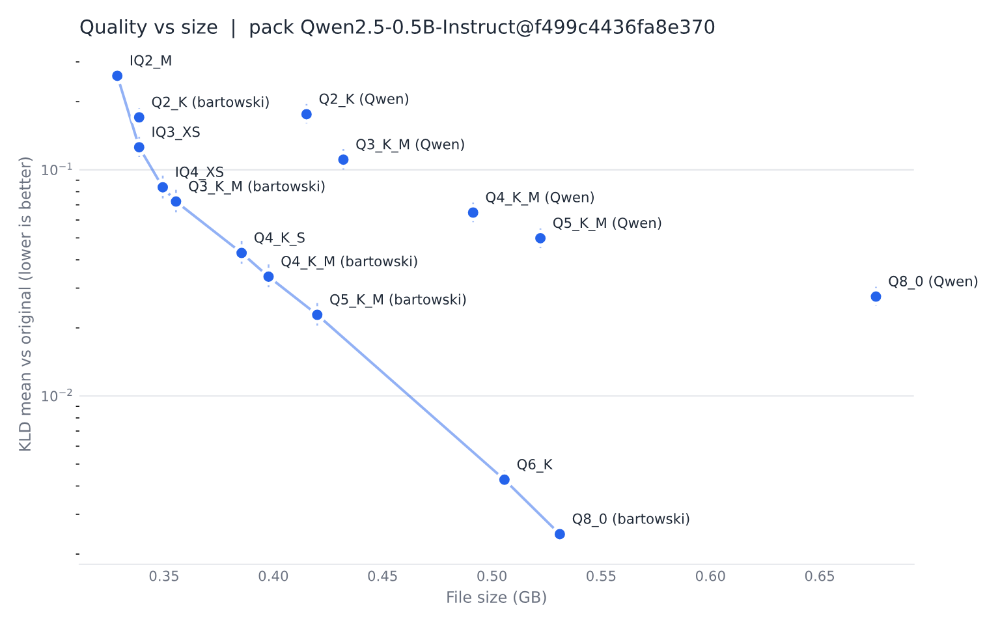

# Sample results: Qwen2.5-0.5B-Instruct

Real measurements made by quantgap 0.1.1. Nothing here is estimated or copied from a publisher.

- **Reference model:** `Qwen/Qwen2.5-0.5B-Instruct` at commit `7ae557604adf67be50417f59c2c2f167def9a775` (Apache-2.0), run in float32 on CPU.
- **Pack (public):** https://huggingface.co/datasets/quantgap-packs/Qwen2.5-0.5B-Instruct, `Qwen2.5-0.5B-Instruct@f499c4436fa8e370`, probe set v1, k=32, 49,013 scored positions, built 2026-11-10T09:37:57Z.
- **Scoring:** llama-cpp-python 0.3.36 with `--n-gpu-layers -1` on Tesla T4 / CUDA (Linux) (a free Google Colab T4), full mode.
- **Submittable:** these are full results (not `--quick`), each with the SHA-256 of its quant file.

| Publisher | Quant | Size | KLD mean (95% interval) | Worst 1% | Top-1 | PPL ratio | Loops (quant / original) | Wrong script | JSON ok |
|---|---|---|---|---|---|---|---|---|---|
| bartowski | Q8_0 | 531.1 MB | 0.0025 (0.0023 to 0.0026) | 0.021 | 97.1% | 1.003 | 27 / 23 | 0 | 7 / 8 |
| bartowski | Q6_K | 505.7 MB | 0.0043 (0.0039 to 0.0047) | 0.039 | 96.6% | 1.003 | 22 / 23 | 0 | 8 / 8 |
| bartowski | Q5_K_M | 420.1 MB | 0.0229 (0.0205 to 0.0258) | 0.249 | 92.3% | 1.023 | 24 / 23 | 0 | 8 / 8 |
| Qwen | Q8_0 | 675.7 MB | 0.0275 (0.0251 to 0.0304) | 0.284 | 91.4% | 1.035 | 27 / 23 | 0 | 8 / 8 |
| bartowski | Q4_K_M | 397.8 MB | 0.0337 (0.0303 to 0.0382) | 0.325 | 90.6% | 1.035 | 29 / 23 | 0 | 8 / 8 |
| bartowski | Q4_K_S | 385.5 MB | 0.0429 (0.0384 to 0.0485) | 0.453 | 89.3% | 1.042 | 22 / 23 | 0 | 8 / 8 |
| Qwen | Q5_K_M | 522.2 MB | 0.0498 (0.0451 to 0.0551) | 0.546 | 88.8% | 1.057 | 24 / 23 | 0 | 8 / 8 |
| Qwen | Q4_K_M | 491.4 MB | 0.0647 (0.0587 to 0.0716) | 0.691 | 87.2% | 1.066 | 31 / 23 | 0 | 8 / 8 |
| bartowski | Q3_K_M | 355.5 MB | 0.0724 (0.0648 to 0.0815) | 0.848 | 86.5% | 1.072 | 27 / 23 | 0 | 8 / 8 |
| bartowski | IQ4_XS | 349.4 MB | 0.0837 (0.0748 to 0.0943) | 1.029 | 86.0% | 1.076 | 27 / 23 | 0 | 7 / 8 |
| Qwen | Q3_K_M | 432.0 MB | 0.1109 (0.1002 to 0.1235) | 1.323 | 83.9% | 1.115 | 26 / 23 | 0 | 8 / 8 |
| bartowski | IQ3_XS | 338.6 MB | 0.1258 (0.1140 to 0.1399) | 1.398 | 82.6% | 1.132 | 31 / 23 | 0 | 8 / 8 |
| bartowski | Q2_K | 338.6 MB | 0.1706 (0.1561 to 0.1872) | 1.831 | 79.6% | 1.197 | 34 / 23 | 0 | 8 / 8 |
| Qwen | Q2_K | 415.2 MB | 0.1761 (0.1605 to 0.1954) | 1.958 | 79.5% | 1.214 | 29 / 23 | 0 | 8 / 8 |
| bartowski | IQ2_M | 328.6 MB | 0.2604 (0.2404 to 0.2829) | 2.453 | 74.9% | 1.310 | 34 / 23 | 0 | 8 / 8 |

Full mode: all 160 texts and 48 generations per quant, llama.cpp on a free Colab Tesla T4 GPU. Lower KLD is better. The original loops in 23 of 48 prompts under plain greedy decoding (common for a 0.5B model), so read the loops column relative to that.



**What the data shows:** bartowski's files form a steady frontier. For the same label, the official Qwen file drifted further in 5 of 5 matched pairs (for example Q4_K_M: 0.0647 for Qwen's 491.4 MB file against 0.0337 for bartowski's 397.8 MB file, about 1.9 times as far and 94 MB bigger). We did not investigate why. A label like `Q4_K_M` names a recipe, not one fixed result, which is the point of measuring.

## Checks

- **Same quant, same subset, two machines:** Q8_0 in `--quick` mode gave KLD 0.002720 on a laptop CPU (Windows) and 0.002694 on the Colab T4 GPU (Linux). The difference is 0.95%, and the number of scored positions is identical (10,493). This is the only cross-machine replication so far.
- **Quick versus full:** earlier quick-mode runs (first 25% of each group) of seven of these quants agreed with the full results within their 95% intervals for six of the seven. Q6_K's full result (0.0043) fell just below its quick interval (0.0057 to 0.0083), which is plausible for 95% intervals computed on a quarter of the data.
- **Interpretation:** the loop counts are noisy. The original itself loops in 23 of 48 prompts under plain greedy decoding. Wrong-script and JSON checks found almost nothing to flag on this model.

## Quant files (SHA-256)

The 15 result files are in [`results/`](results/).

- `25130a98aa782284a7dabea0c23245b2fd371ed47244e79d78b8ec23245fdf96` bartowski Q8_0
- `32c14c29a44712c02e29d5c2605593ece92ccb7a4358f56016a42b151434c842` bartowski Q6_K
- `a0a413dcbb4676f21d4c951b98a393324694edb1a20a4f9547d1de8d2919ff3b` bartowski Q5_K_M
- `ca59ca7f13d0e15a8cfa77bd17e65d24f6844b554a7b6c12e07a5f89ff76844e` Qwen Q8_0
- `6eb923e7d26e9cea28811e1a8e852009b21242fb157b26149d3b188f3a8c8653` bartowski Q4_K_M
- `988083e5e5f2b6060d32f349b7e2d9e253f352e9cd3ead40fab6889041654249` bartowski Q4_K_S
- `041474553fcabfc2a2d67903f9d2c2e50bd92528e670da4f33b5d0ce6e59fd55` Qwen Q5_K_M
- `74a4da8c9fdbcd15bd1f6d01d621410d31c6fc00986f5eb687824e7b93d7a9db` Qwen Q4_K_M
- `e14591771b0a3070c50ff11ee6055ffbb25f0bf50b6f9474ec4a16ff4ace8df6` bartowski Q3_K_M
- `df178ccd68e24ce0c74f957765c00e8f5eec5c51216a1acd4444202e58df6cc1` bartowski IQ4_XS
- `590d2479d401db206fe12a4562294d2de6211e06338a6e34fbad64b32f1469d0` Qwen Q3_K_M
- `c010afa79cb0607545b5b1f2af7e0a3a0311b28d33dadd92a9895f383f51a8e0` bartowski IQ3_XS
- `c929ba8be98f584d0872923e373bda0da8a261eae05dd362590c9792adfc76d2` bartowski Q2_K
- `9ee36184e616dfc76df4f5dd66f908dbde6979524ae36e6cefb67f532f798cb8` Qwen Q2_K
- `2fc237e65e1f963310e9c961d8e71e932734a72f90e3216a972d83edd1feb756` bartowski IQ2_M

## Reproduce

```bash
pip install "quantgap[pack,llamacpp]" --extra-index-url https://abetlen.github.io/llama-cpp-python/whl/cu124
quantgap pack Qwen/Qwen2.5-0.5B-Instruct --revision 7ae557604adf67be50417f59c2c2f167def9a775 --license apache-2.0 --device cpu
python scripts/seed_launch.py scripts/seed_list_sample.json --n-gpu-layers -1
```

A new pack has a different id (it holds a timestamp), so use the public pack above to get comparable numbers. On a GPU runtime with CUDA 13 (Colab), llama.cpp's CUDA 12 build also needs `pip install nvidia-cuda-runtime-cu12 nvidia-cublas-cu12` and those folders on `LD_LIBRARY_PATH`.
